# 🧬 Methylation Pipeline

[](https://doi.org/10.5281/zenodo.15150516)
[](LICENSE)

A Python pipeline for **longitudinal analysis of cell-free DNA (cfDNA) methylation** from enzymatic methyl-seq (EM-seq) data. It takes CpG island (CGI) fragment counts from one or more sequencing runs, converts them into normalized methylation signals, summarizes them at the gene level, and tracks how methylation changes across treatment timepoints within each patient and across a cohort, with comparisons to healthy controls.

The pipeline works at three levels:

| Level | Question it answers | Example outputs |
|:--|:--|:--|
| **Global** (sample) | How does overall methylation signal change over the course of treatment? | Condition dotplots, per-patient trajectories, box/violin plots |
| **Locus** (CpG island / chromosome) | Which regions and chromosomes change most between timepoints? | Bubble plots, per-chromosome change, top differentially methylated CGIs |
| **Gene** | Which genes carry the strongest signal, and how does each gene's rank shift over treatment? | Gene rank trajectories, top-gene heatmaps, paired t-tests |

> **Early detection.** The [`early_detection/`](early_detection/) folder applies the same normalization to a different design: plasma drawn 15-9 and 9-3 months before a cancer diagnosis and near diagnosis, compared with healthy controls. It reconstructs the pipeline's first (2024) use case and runs end to end on a synthetic demo dataset. See [`early_detection/README.md`](early_detection/README.md).

---

## 📑 Contents

- [Workflow overview](#-workflow-overview)
- [Early detection (separate folder)](early_detection/README.md)
- [Quick start](#-quick-start)
- [Input requirements](#-input-requirements)
- [Preprocessing (Steps 1–6)](#-preprocessing-steps-16)
- [Global-level analysis](#-global-level-analysis)
- [Locus-level analysis](#-locus-level-analysis)
- [Gene-level analysis and ranking](#-gene-level-analysis-and-ranking)
- [Script versions](#-script-versions)
- [Project structure](#-project-structure)
- [Known limitations](#-known-limitations)
- [Testing](#-testing)
- [Changelog](#-changelog)
- [CGI naming format](#-cgi-naming-format)
- [Citation](#-citation)
- [License](#-license)

---

## 🗺 Workflow overview

```
data/ (EM-seq CGI count files + patient ID list)
   │
   ├─ Step 1  Filter samples by patient ID
   ├─ Step 2  Merge runs from multiple EM-seq batches        (optional)
   ├─ Step 3  Glob20 / GlobMin80 ratio → scaled methylation signal
   ├─ Step 4  Parse CGI names into gene annotations           (needed for gene-level)
   ├─ Step 5  Build CGI → gene map                            (needed for gene-level)
   └─ Step 6  Sum CGI signals into a gene × sample matrix     (needed for gene ranking)
   │
   ├─▶ Global analysis   (scripts/global/)
   ├─▶ Locus analysis    (scripts/locus/)
   └─▶ Gene analysis     (scripts/locus/ — gene rank and top-gene scripts)
```

---

## ▶️ Quick start

```bash
git clone https://github.com/codebyesther/methylation-pipeline.git
cd methylation-pipeline
pip install -r requirements.txt

mkdir -p data output plots
# place your patient ID list and EM-seq Excel files in data/

python scripts/step_1_filter_patients_local.py
python scripts/step_2_merge_filtered_files.py        # if you have multiple runs
python scripts/step_3_convert_to_aberrant_signals_v3-matchingRowColumnNames.py
python scripts/step_4_generate_gene_annotation.py
python scripts/step_5_build_gene_cgi_map.py
python scripts/step_6_gene-methylation-matrix.py
```

Then run any of the analysis scripts below. All scripts are run from the repository root and read from `data/` and `output/`, writing results to `output/` and `plots/`.

**Requirements:** Python 3 with `pandas`, `numpy`, `openpyxl`, `matplotlib`, `seaborn`, `scipy`, `tqdm` (see `requirements.txt`).

---

## 📁 Input requirements

Place all inputs in `data/`.

**1. Patient ID list** (`.xlsx`)
- Patient IDs in the first column.
- The filename must contain `patient` in any capitalization, e.g. `Patient ID list.xlsx`.
- IDs match sample names as whole words: `PT01` matches `PT01_Baseline` but not `PT010_C2D1`.
- To keep the healthy controls, add `INNOV` as one of the rows.

| Patient ID |
|:--|
| PT001 |
| PT002 |
| PT003 |

**2. EM-seq methylation files** (`.xlsx`)
- One row per CpG island, with CGI names in the first column (e.g. `CGI_chr1_778604_779167_LOC100288069_0`).
- One column per sample. Each column name must contain the patient ID and a timepoint label.
- A summary row labeled `Total CpG island fragments counts for this particular spreadsheet` holds the total CGI fragment count per sample. The global-level scripts use this row.
- Each run is expected as a pair of files: a **Glob20** file and a **GlobMin80** file, used together in Step 3.

**Sample naming conventions.** Timepoints are read from the sample (column) names:

| Label in sample name | Interpreted as |
|:--|:--|
| `Baseline` | Baseline (pre-treatment) |
| `C<n>` (e.g. `C2D1`, `C1D15`) | Treatment cycle *n* (On-Treatment) |
| `Off-tx` | Off treatment (Post-Treatment) |
| `INNOV` | Healthy control |

Example sample names: `PT001_Baseline`, `PT001_C2D1`, `PT001_C7D1-Off-tx`, `INNOV_control_01`.

---

## 🔧 Preprocessing (Steps 1–6)

### Step 1 — Filter by patient ID
`scripts/step_1_filter_patients_local.py`

- Reads the patient ID list and every methylation Excel file in `data/`.
- Keeps only the sample columns that belong to the listed patients (whole-word ID match; list `INNOV` to keep healthy controls).
- Writes one filtered file per input to `output/` (e.g. `EMSeq-NN-Run-1_..._Glob20_cpgi_counts.xlsx_samples-of-interest`).

### Step 2 — Merge multiple EM-seq runs *(optional)*
`scripts/step_2_merge_filtered_files.py`

- Needed only if your samples span more than one sequencing run.
- Finds the filtered files in `output/` with `Glob20` or `GlobMin80` in their names and merges each set by row label.
- Outputs `output/merged_output_glob20.xlsx` and `output/merged_output_globmin80.xlsx`.

### Step 3 — Convert to normalized methylation signal
`scripts/step_3_convert_to_aberrant_signals_v3-matchingRowColumnNames.py`

- Reads `output/merged_output_glob20.xlsx` and `output/merged_output_globmin80.xlsx` from Step 2. With a single sequencing run, it uses the one pair of Step 1 files instead.
- Matches CpG islands and samples **by name**, then divides each Glob20 count by the GlobMin80 count of the same CGI and sample, x 100,000.
- GlobMin80 = 0 with Glob20 > 0 is written as `INF` (red in Excel) and logged to `output/inf_locations_log.csv` and `output/inf_summary.csv`; 0 / 0 is written as 0. Downstream scripts treat `INF` as missing.
- Outputs `output/scaled_fragment_ratios_matrix.xlsx`:

| Row | Content |
|:--|:--|
| 1 | `Scaled ratio of totals (Glob20 / GlobMin80 x 100000)`: the sample-level signal used by the global scripts |
| 2 | `Total CpG island fragments counts for Glob20` (raw) |
| 3 | `Total CpG island fragments counts for GlobMin80` (raw) |
| 4+ | one row per CGI |

Earlier Step 3 versions are in `scripts/legacy/`.

### Step 4 — Annotate genes
`scripts/step_4_generate_gene_annotation.py`

- Reads an Excel file with `matrix` in its name from `output/`.
- Parses each `CGI_...` name into chromosome, start, end, gene name(s) and index.
- Outputs `output/structured_gene_annotation.csv`.

### Step 5 — Build the CGI → gene map
`scripts/step_5_build_gene_cgi_map.py`

- Reads the `gene_annotation` file from Step 4.
- Reshapes it into one row per CGI–gene pair, with CGI IDs in `chr:start-end` format.
- Outputs `output/gene_cgi_map.csv`.

| cgi_id | gene_name |
|:--|:--|
| chr1:778604-779167 | LOC100288069 |
| chr1:827036-828065 | LINC00115 |
| chr1:940225-942983 | SAMD11 |

### Step 6 — Build the gene methylation matrix
`scripts/step_6_gene-methylation-matrix.py`

- Reads `output/merged_output_glob20.xlsx` (or the single Step 1 Glob20 file).
- Sums the Glob20 fragment counts of the CpG islands that list each gene, giving one value per gene per sample. Genes are matched by **exact symbol** (`GATA2` no longer collects `GATA2-AS1`); an island listing two genes counts toward both.
- Outputs `output/gene_methylation_matrix.csv` (genes × samples). This is the input for the gene-rank scripts.

---

## 🌐 Global-level analysis

These scripts use each sample's **scaled ratio of totals**: total Glob20 fragments / total GlobMin80 fragments x 100,000 (row 1 of the Step 3 output). Older Step 3 files without that row are handled by computing it from the two raw total rows.

### Dotplots by condition
`scripts/global/dotplots-by-condition.py`

- Input: `output/*fragment_ratios_matrix*.xlsx` (from Step 3).
- Groups samples into Healthy, Baseline, On-Treatment and Post-Treatment, and computes the n, mean, median and SD for each group.
- Outputs to `plots/dotplots/`: `*_summary_stats.csv`, `*_median_dotplot.png`, `*_mean_sd_dotplot.png`.

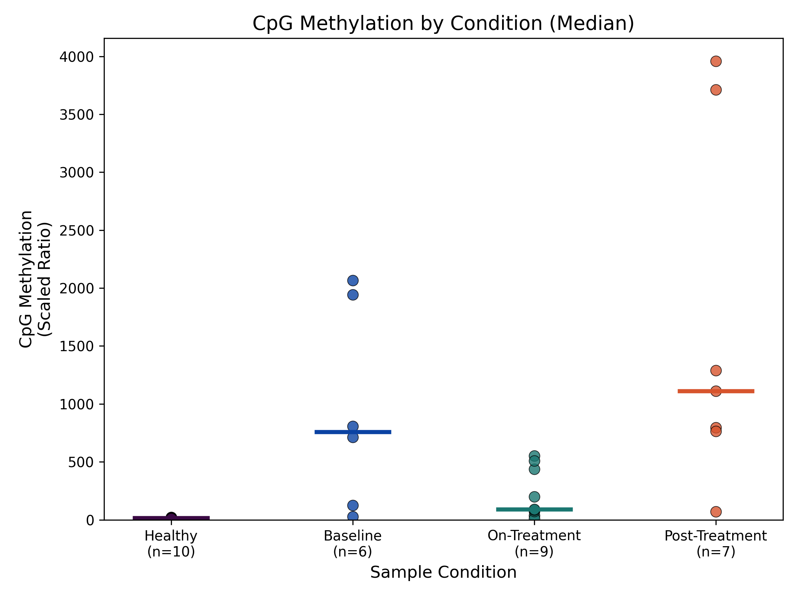 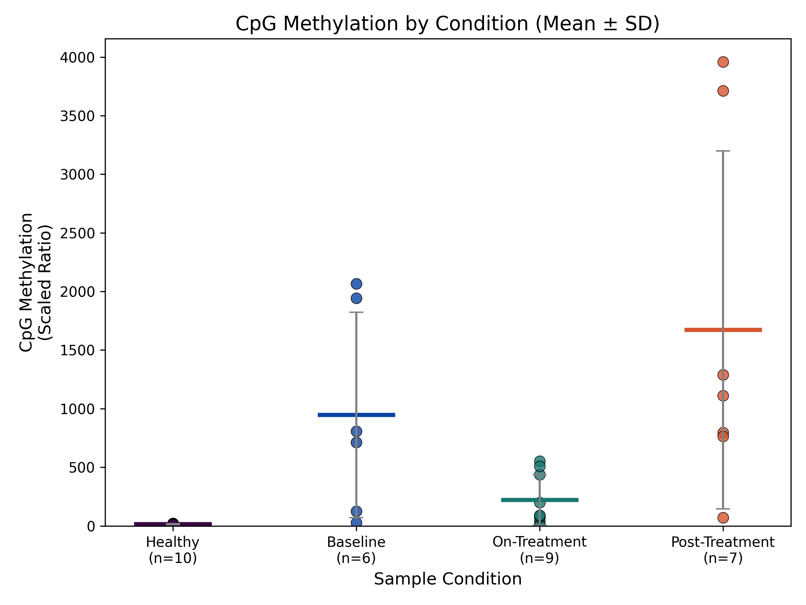

### Per-patient trajectories
`scripts/global/lineplots-perpatient_v3.py` (grouped timepoints)
`scripts/global/lineplots-perpatient_v4.py` (individual treatment cycles)

- Input: `output/scaled_fragment_ratios_matrix.xlsx`.
- `v3` groups samples into Baseline / On-Treatment / Post-Treatment. `v4` keeps each treatment cycle as its own point on the x-axis.
- Plots: longitudinal trajectories for all patients, the average trajectory, box plots, violin + swarm plots, and one plot per patient.
- Tables: `sample_metadata.csv`, `summary_statistics.csv`, `boxplot_summary_by_timepoint.csv`, and per-patient replicate tables in `output/per_patient_tables/`.
- `v3` writes plots to `plots/lineplots/`. `v4` writes them to `plots/global-lineplots/`.

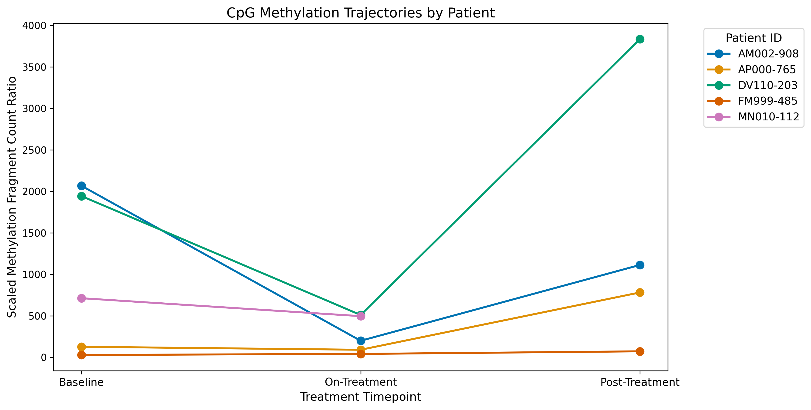
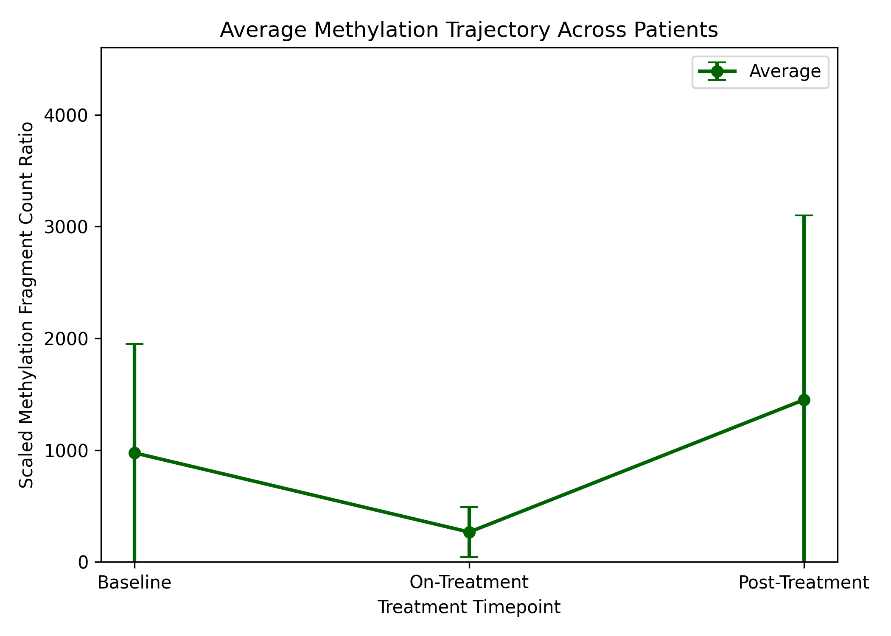 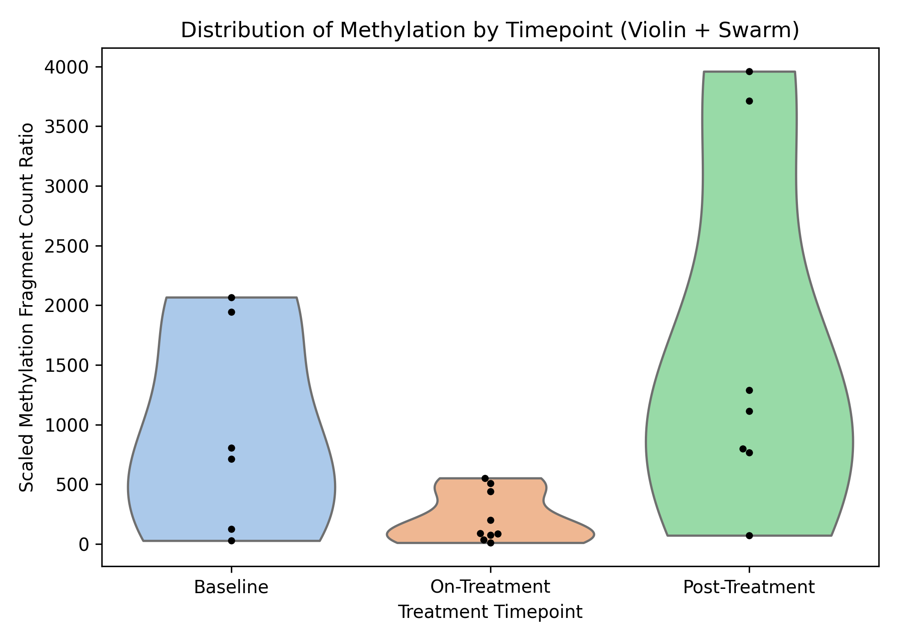

### Plot by cycle *(utility)*
`scripts/plot-by-cycle.py`

A short helper that draws line plots from a manually assembled table (patients × cycle groups). It reads a fixed file path, so edit `data_file` before using it.

---

## 🔍 Locus-level analysis

### Average methylation change per chromosome
`scripts/locus/avg-methylation-change-per-chromosome.py`

- Inputs: a `patient` file in `data/` and a `scaled` `.xlsx` file in `output/`.
- Averages CGI signal per chromosome for each patient and timepoint (healthy controls excluded), then computes the change between timepoints.
- Outputs to `plots/avg-methylation-change-per-chromosome/`: `chr_avg_overlay_<name>_aligned.png` and `chr_avg_summary_<name>.xlsx`. Chromosomes are shown in karyotype order.

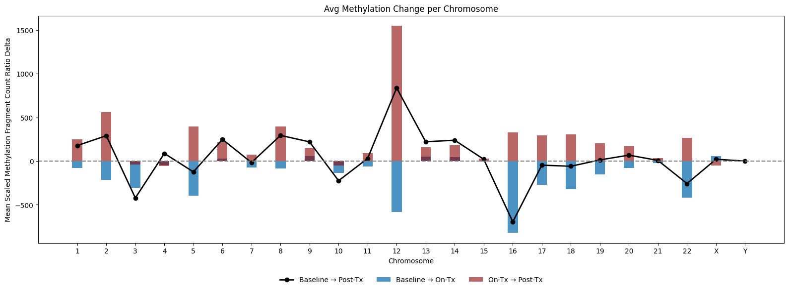

### Bubble plots of CGI methylation along each chromosome
`scripts/locus/bubbleplot_generator_v9_gridsoff.py` (latest)

- Inputs: a `*ratios_matrix*` file in `output/` and a `patient` file in `data/`.
- For each patient and chromosome, plots every CpG island at its genomic midpoint, sized and colored by signal, with one row per timepoint. Also makes cohort-averaged plots for each chromosome.
- Saves PNG and SVG files, bundled into `plots/bubbleplots.zip`.
- `merged-glob20-bubbleplot.py` produces the same plots directly from `output/merged_output_glob20.xlsx`.

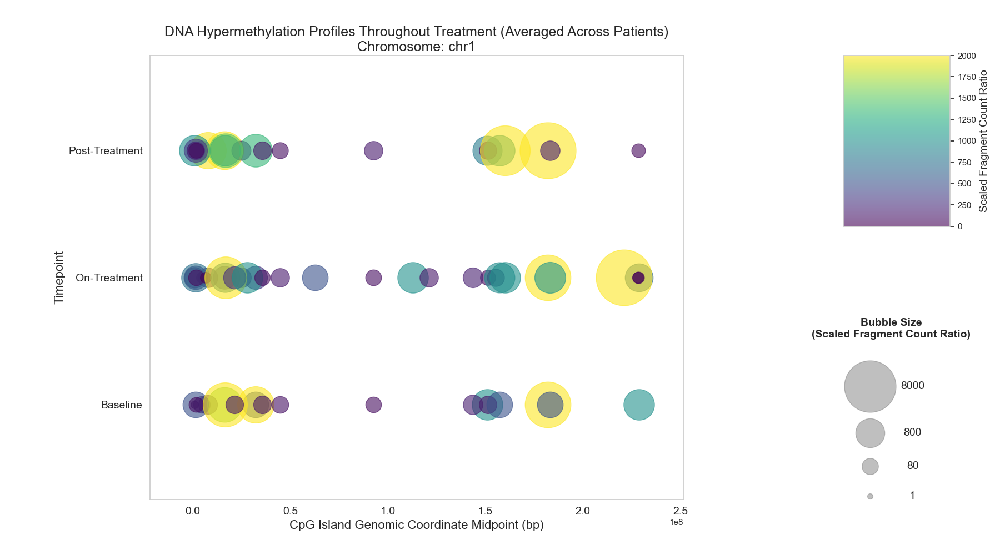

### Top 10 differentially methylated CGIs and multi-CGI genes
`scripts/locus/top10dm-plots_using-map_v4.py` (latest)

- Inputs: the patient list in `data/`, `output/scaled_fragment_ratios_matrix.xlsx`, and `output/gene_cgi_map.csv` (Step 5).
- Averages each CGI across patients at each timepoint, then finds the 10 CGIs with the largest change for Baseline → On-Treatment, Baseline → Post-Treatment, and On-Treatment → Post-Treatment.
- Also identifies genes with more than one affected CGI.
- Outputs bar charts plus the intermediate tables (`v3`/`v4`), bundled into a zip file in `plots/`.

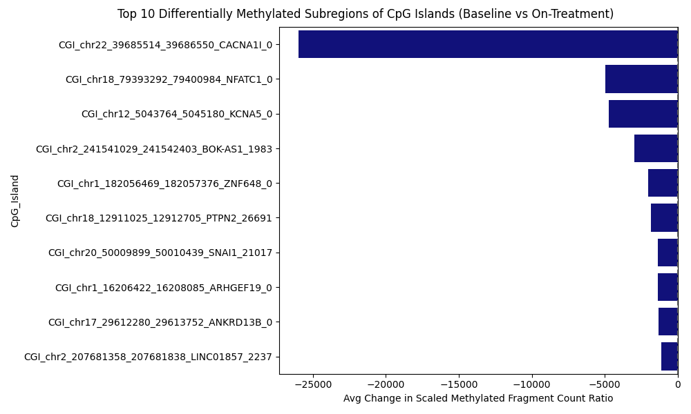 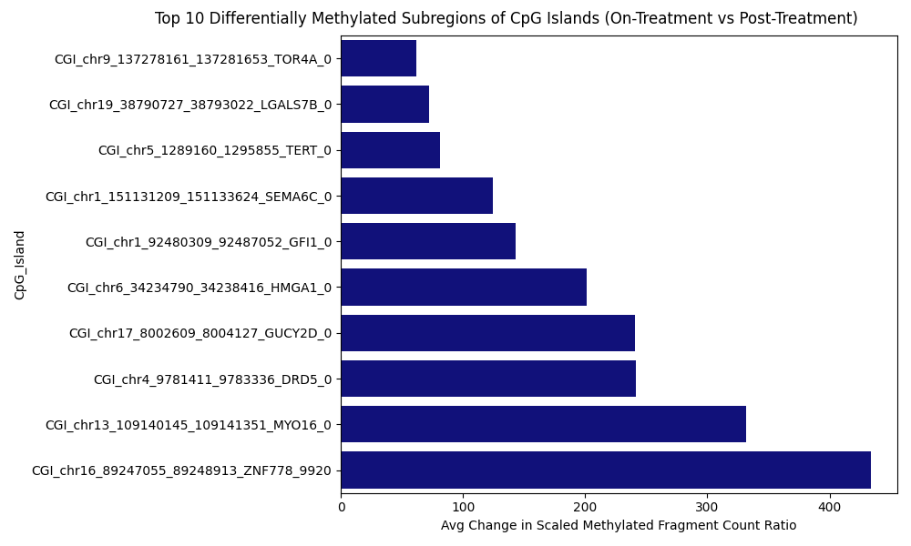 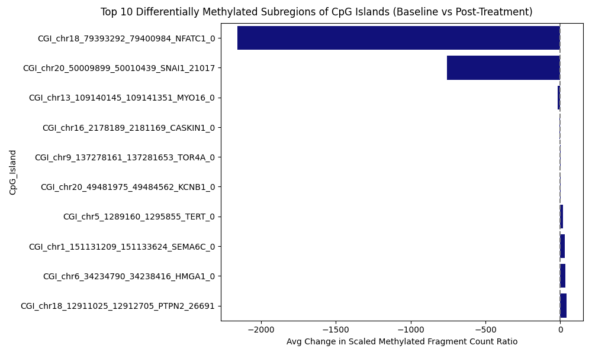

---

## 🧪 Gene-level analysis and ranking

### Gene rank trajectories
`scripts/locus/gene_rank_slopeplot_top10_colored_v2.py` (recommended)

This is the gene-ranking part of the pipeline. Instead of comparing raw signal values, which can vary in scale between samples and runs, it compares each gene's **rank** within its sample.

1. **Rank genes within each sample.** Genes are ranked by methylation signal (rank 1 = most methylated). Genes ranked 501 or lower are grouped together at rank 501 to reduce noise from genes with little signal.
2. **Assign patients and timepoints.** Each sample is mapped to its patient and timepoint (Baseline, each treatment cycle, Off-Tx, or Healthy).
3. **Average replicates.** Ranks from replicate samples (same patient, same timepoint) are averaged.
4. **Track each gene over time.** For each patient, a slope plot follows every gene's rank from baseline through each treatment cycle to the end of treatment. Genes that rank in the top 10 at any of that patient's timepoints are highlighted.

- Input: `output/gene_methylation_matrix.csv` (from Step 6) and the patient ID list.
- Outputs to `plots/rank-slopeplot/`:
  - `rank_slopeplot_patient_<ID>.png`: rank trajectories for each patient (log scale)
  - `gene_methylation_ranks.csv`: the full gene × sample rank matrix
  - `melted_gene_methylation_ranks_avg.csv`: ranks in long format, averaged over replicates
  - `top_genes_per_patient.csv`: the highlighted top genes for each patient

Earlier variants (rank cap of none, 21 or 501; no replicate averaging) are in `scripts/legacy/locus/`.

### Top genes: deltas, paired t-tests and heatmaps
`scripts/locus/top10genes-heatmap-barplot.py`

- Inputs: a `matrix` file in `output/`, a `patient` file in `data/`, and `output/gene_cgi_map.csv`.
- Builds a gene-level matrix (genes with multiple CGIs), computes each gene's change between timepoints for every patient, and runs **paired t-tests** for Baseline vs On-Treatment, Baseline vs Post-Treatment, and On-Treatment vs Post-Treatment.
- Selects the top 10 genes by size of the Baseline → Post-Treatment change and plots heatmaps, line plots and bar plots.
- Outputs to `plots/heatmaps-lineplots/`: `gene_deltas_all_comparisons.csv`, `*_ttest.csv`, `patient_deltas_*.csv`, `top10_gene_deltas_*.csv`, `gene_methylation_matrix.csv`, and figures.

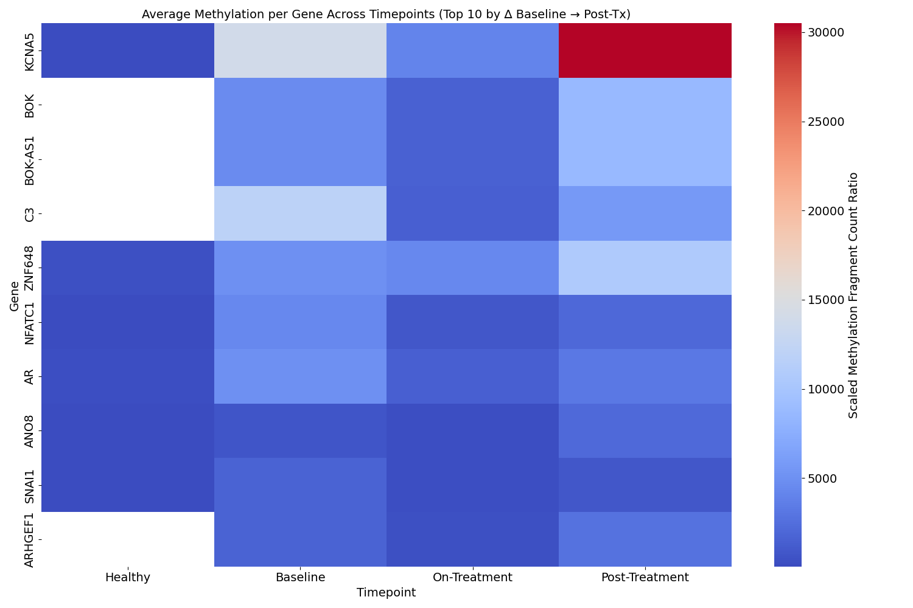 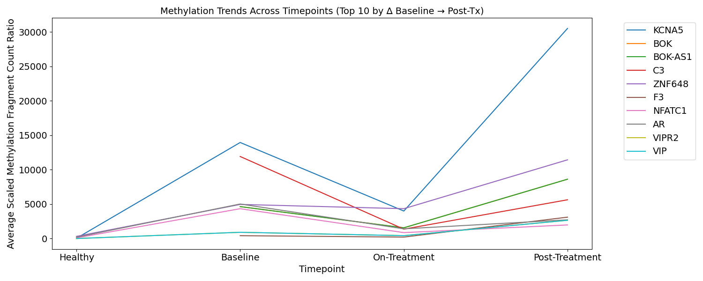

### Top genes across individual treatment cycles
`scripts/locus/top10genes-barplot-heatmap-lineplot.py`

- Inputs: `output/merged_output_glob20.xlsx`, a `patient` file, and `output/gene_cgi_map.csv`.
- Selects the 10 genes with the highest baseline signal and follows them across each treatment cycle (not grouped timepoints).
- Outputs to `plots/heatmaps-lineplots/`: `heatmap_top10_genes_detailed_timepoints.png`, plus cohort and per-patient line plots in `gene-lineplots/`.

---

## 🗂 Script versions

Each analysis has one current script (listed in the sections above). Earlier versions were moved, unchanged, to [`scripts/legacy/`](scripts/legacy/) so old figures can be reproduced; its README lists what each one was replaced by.

| Purpose | Current script |
|:--|:--|
| Step 3 signal conversion | `step_3_convert_to_aberrant_signals_v3-matchingRowColumnNames.py` |
| Global trajectories | `global/lineplots-perpatient_v3.py` (grouped) or `_v4.py` (per cycle) |
| Bubble plots | `locus/bubbleplot_generator_v9_gridsoff.py` |
| Top differentially methylated CGIs | `locus/top10dm-plots_using-map_v4.py` |
| Gene heatmaps / t-tests | `locus/top10genes-heatmap-barplot.py` |
| Gene rank trajectories | `locus/gene_rank_slopeplot_top10_colored_v2.py` |

---

## 📂 Project structure

```
methylation-pipeline/
├── data/                         # Inputs (not tracked): patient list, EM-seq Excel files
├── output/                       # Intermediate matrices and tables
├── plots/                        # Figures and summary tables
├── sampleimages/                 # Example figures used in this README
├── early_detection/              # Pre-diagnosis vs healthy-control version (own README)
├── scripts/
│   ├── common.py                 # shared helpers: file detection, patients, timepoints, genes
│   ├── step_1_filter_patients_local.py
│   ├── step_2_merge_filtered_files.py
│   ├── step_3_convert_to_aberrant_signals_v3-matchingRowColumnNames.py
│   ├── step_4_generate_gene_annotation.py
│   ├── step_5_build_gene_cgi_map.py
│   ├── step_6_gene-methylation-matrix.py
│   ├── plot-by-cycle.py
│   ├── global/
│   │   ├── dotplots-by-condition.py
│   │   ├── lineplots-perpatient_v3.py
│   │   └── lineplots-perpatient_v4.py
│   ├── locus/
│   │   ├── avg-methylation-change-per-chromosome.py
│   │   ├── bubbleplot_generator_v9_gridsoff.py
│   │   ├── top10dm-plots_using-map_v4.py
│   │   ├── top10genes-heatmap-barplot.py
│   │   ├── top10genes-barplot-heatmap-lineplot.py
│   │   └── gene_rank_slopeplot_top10_colored_v2.py
│   └── legacy/                   # earlier versions, unchanged (see its README)
├── tests/
│   ├── make_synthetic_data.py    # synthetic dataset in the lab file layout
│   ├── run_pipeline.sh           # runs every current script on it
│   └── test_common.py            # unit tests (pytest)
├── CITATION.cff
├── LICENSE
├── README.md
└── requirements.txt
```

---

## ⚠️ Known limitations

- **Timepoint parsing depends on sample names** following the conventions in [Input requirements](#-input-requirements): `Baseline`, `C<n>`, `Off-tx` (any capitalization; `off_tx` also works), `INNOV` for healthy controls. Anything else is treated as On-Treatment.
- **File auto-detection.** If more than one file matches (e.g. two patient lists), scripts print a note and use the first in alphabetical order. Keep one candidate per keyword in `data/` and `output/`.
- **Within-patient ranking.** The gene-rank scripts track rank changes within each patient. They don't run a statistical test that combines ranks across patients.
- **Paired t-tests on few patients.** `top10genes-heatmap-barplot.py` reports p-values without multiple-testing correction; with a handful of patients treat them as descriptive.
- **`plot-by-cycle.py`** still reads a fixed file path; edit `data_file` before using it.

---

## ✅ Testing

```bash
pip install -r requirements.txt pytest
python -m pytest tests early_detection/tests    # unit tests
bash tests/run_pipeline.sh                      # every current script on synthetic data
```

`run_pipeline.sh` works in a temporary folder, so your `data/`, `output/` and `plots/` are not touched.

---

## 📝 Changelog

**1.2.0**
- **Global plots now show the scaled ratio.** With the v2/v3 Step 3 output, the dotplot and trajectory scripts read the first data row, which was the raw Glob20 total, not the Glob20 / GlobMin80 ratio. Step 3 now writes the ratio of totals as a labeled first row and the scripts read it by name.
- **Step 3 runs on current pandas** (the removed `mode.use_inf_as_na` option made it fail), works with a single run, and writes 0 / 0 as 0 instead of `INF`.
- **`INF` cells are treated as missing.** `pd.to_numeric` reads the text `INF` as infinity, which made averages and deltas infinite and broke the bubble plots.
- **Exact gene matching** in Step 6 and the gene scripts (`GATA2` vs `GATA2-AS1`, `APC` vs `APCDD1`); `top10dm` now keeps chrX/chrY islands and every gene of a multi-gene island.
- **Whole-word patient matching** (`PT01` vs `PT010`) and case-insensitive patient-list detection everywhere; the gene-rank script no longer needs the fixed file name.
- `top10genes-heatmap-barplot.py` reads the Step 3 matrix even when `gene_methylation_matrix.csv` is also in `output/`.
- Bubble plots: fixed for pandas 3 and for CpG islands with no gene symbol.
- Per-chromosome plot: the two bar series are side by side instead of on top of each other.
- Superseded versions moved to `scripts/legacy/`; added `scripts/common.py`, tests and a synthetic dataset.

**1.1.0** Added `early_detection/`.

**1.0.0** First release.

---

## 🧠 CGI naming format

`CGI_chr1_778604_779167_LOC100288069_0`

| Part | Meaning |
|:--|:--|
| `CGI_` | CpG island prefix |
| `chr1` | Chromosome |
| `778604_779167` | Start and end coordinates |
| `LOC100288069` | Associated gene |
| `_0` | CGI index / probe ID |

---

## 📖 Citation

If you use this code, please cite:

> Choi, E. (2025). *Methylation Pipeline* (Version 1.0.0) [Computer software]. Zenodo. https://doi.org/10.5281/zenodo.15150516

Citation metadata is also available in [`CITATION.cff`](CITATION.cff) (use **"Cite this repository"** on GitHub).

---

## 📜 License

Released under the [MIT License](LICENSE).
