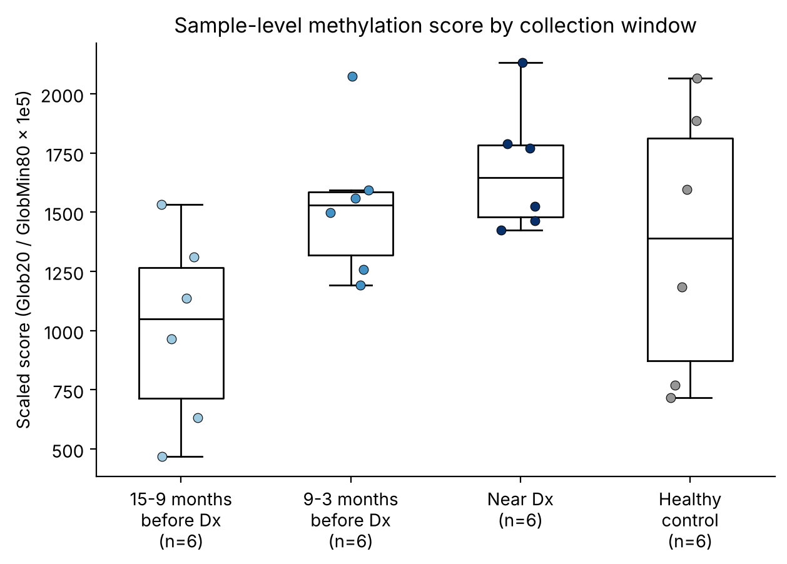
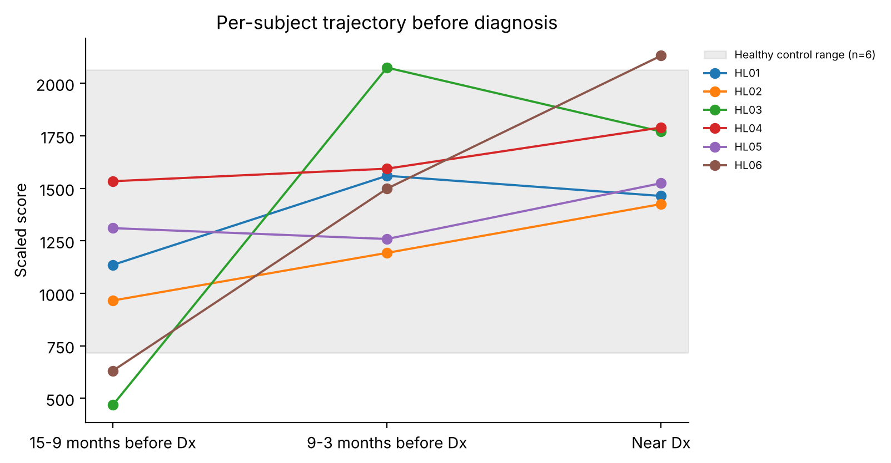
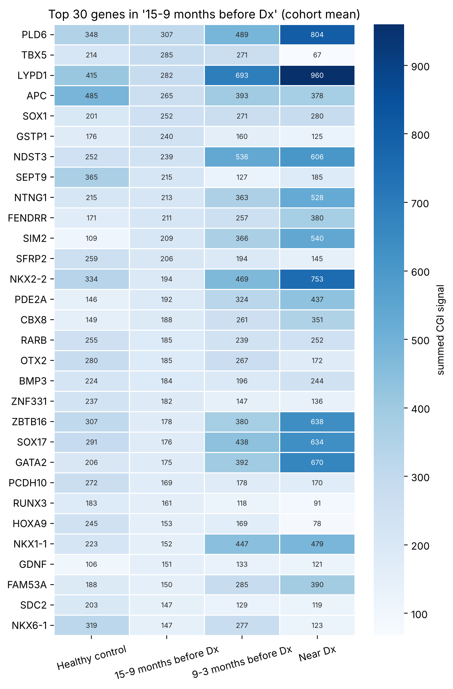
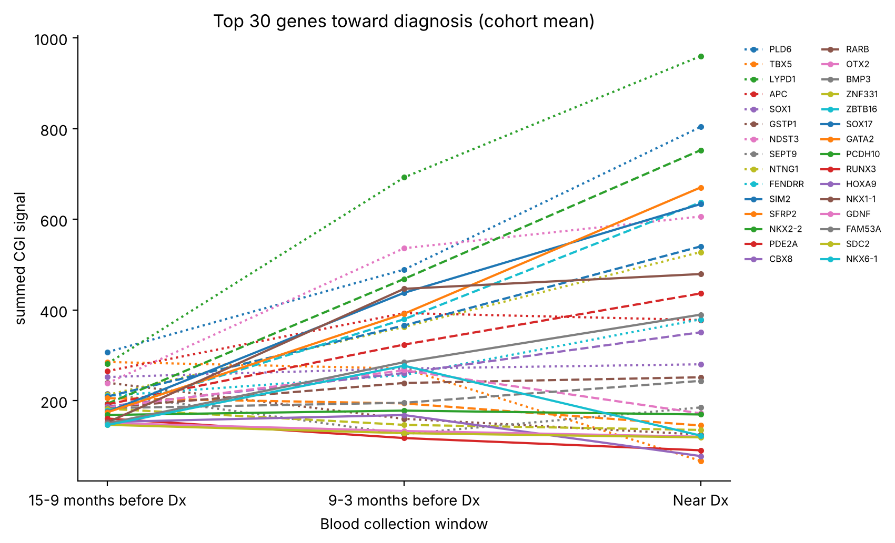
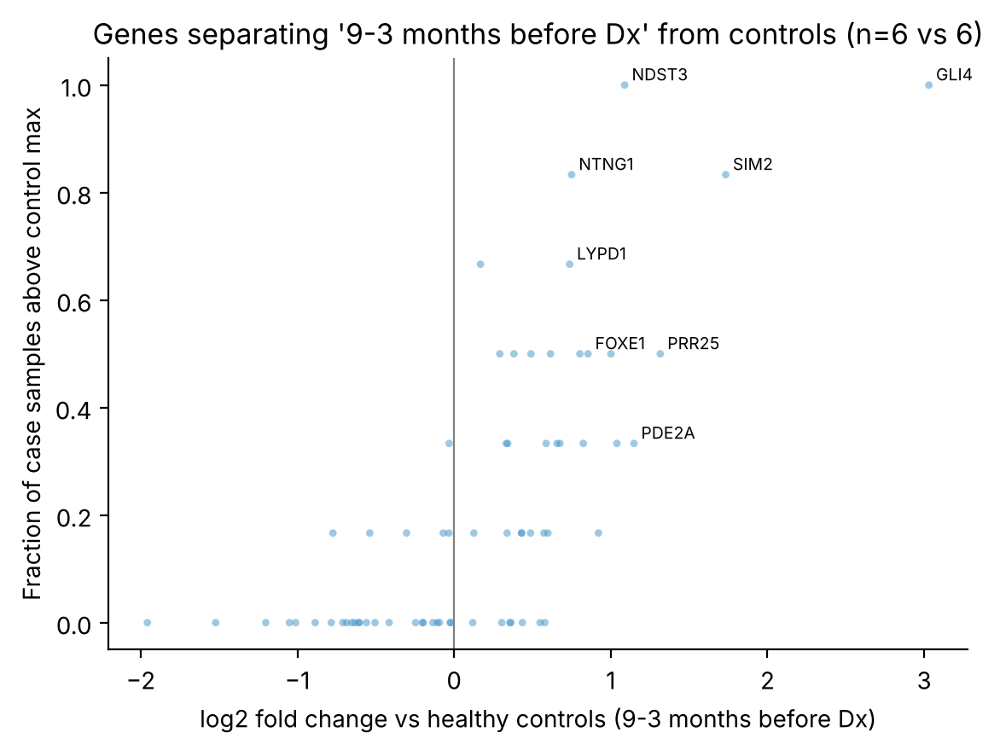

# Early detection: cfDNA methylation before diagnosis

This folder applies the methylation pipeline to an **early-detection** question: does aberrant cfDNA methylation appear in blood drawn **before** a cancer diagnosis, and which genes carry it, compared with healthy controls?

The main pipeline in the repository root follows patients **through treatment** (Baseline, treatment cycles, Off-treatment). This folder uses the same normalization idea on a different study design:

| | Treatment monitoring (repo root) | Early detection (this folder) |
|:--|:--|:--|
| Timepoints | Baseline, treatment cycles, Off-tx | 15-9 months before Dx, 9-3 months before Dx, near Dx |
| Comparison | Each patient against their own earlier samples | Pre-diagnosis samples against healthy controls |
| Main question | Does the signal follow treatment response? | Is there signal before diagnosis, and which genes? |

> **History.** The first version of this analysis was written in 2024 as Google Colab notebooks for a project on HIV-positive individuals who later developed lymphoma, using plasma drawn about 12 and 6 months before diagnosis and near diagnosis, plus healthy controls. Those notebooks were later turned into the treatment-monitoring scripts in the repository root, and the early-detection scripts were lost. This folder is a **2026 reconstruction** of that analysis, rebuilt from the original notebooks and the current pipeline. It includes no patient data: all example files and figures come from a synthetic dataset.

---

## Workflow

```
data/  (lab CGI count files + subject ID list)
  │
  ├─ Step 1  Keep study samples, assign each to a collection window
  ├─ Step 2  Merge sequencing runs                          (optional)
  ├─ Step 3  Depth-scaled signal: Glob20 / GlobMin80
  ├─ Step 4  CGI → gene, gene × sample matrix
  └─ Step 5  Average per gene within each window
  │
  ├─▶ analysis/global_signal.py     sample-level score by window, vs controls
  ├─▶ analysis/top_genes.py         top genes at the earliest window, followed to Dx
  └─▶ analysis/control_contrast.py  genes that separate cases from controls (+ GSEA .rnk)
```

## Quick start

```bash
cd early_detection
pip install -r ../requirements.txt
bash run_demo.sh            # builds a synthetic dataset and runs every step
python -m pytest tests      # unit tests (needs pytest)
```

To run on your own data, put the files described below in `early_detection/data/` and run the steps in order:

```bash
python scripts/step_1_filter_samples.py
python scripts/step_2_merge_runs.py              # only if samples span several runs
python scripts/step_3_scaled_signal.py
python scripts/step_4_gene_matrix.py
python scripts/step_5_window_summary.py
python scripts/analysis/global_signal.py
python scripts/analysis/top_genes.py --top 30 --rank-window pre12
python scripts/analysis/top_genes.py --top 30 --rank-window pre12 --subject <ID>
python scripts/analysis/control_contrast.py
```

Every script has `--help`. Tables go to `output/`, figures to `plots/`.

---

## Inputs

**1. Subject ID list** (`.xlsx`, file name containing `subject` or `patient`): IDs in the first column. Include both cases and healthy controls.

**2. CGI count files** (`.xlsx`) from the lab preprocessing, one pair per sequencing run:

- a **numerator** file (default keyword `Glob20`): fragments from CpG islands that are lowly methylated in healthy cells, i.e. unexpected methylation
- a **reference** file (default keyword `GlobMin80`): fragments from CpG islands that are normally methylated in healthy cells, which scale with input and sequencing depth

Layout: first column holds row labels; rows starting with `CGI_` are CpG islands (e.g. `CGI_chr1_778604_779167_LOC100288069_0`); one row whose label contains `Total CpG island fragments counts` holds per-sample totals. Other rows (pool, cancer type) are ignored. If the total row is missing, the CGI rows are summed.

Other filter combinations work too: pass `--numerator` and `--reference` keywords to steps 2 and 3 (the 2024 notebooks used a `Max40` numerator file).

**Sample names** decide the collection window. Matching is case-insensitive:

| Window key | Label | Sample name contains (examples) |
|:--|:--|:--|
| `pre12` | 15-9 months before Dx | `12m`, `12-months` |
| `pre6` | 9-3 months before Dx | `6m`, `6-months` |
| `near` | Near Dx | `near-Dx`, `at-cancer`, `atDx` |
| `control` | Healthy control | `control`, `healthy`, `INNOV`, `ctrl` |

Examples: `HL01_12m`, `HL01_6m`, `HL01_near-Dx`, `CTRL01_control`. To use other labels, edit the `WINDOWS` table in `scripts/edcommon.py`. Step 1 reports samples that match an ID but no window instead of dropping them silently.

---

## Steps

**Step 1: filter samples** (`step_1_filter_samples.py`). Keeps columns whose name contains a listed ID and a recognizable window. Writes `output/<file>_filtered.xlsx`.

**Step 2: merge runs** (`step_2_merge_runs.py`, optional). Joins runs by CGI name; CGIs absent from a run count as 0 for that run's samples. Keywords are matched exactly, so `Glob20` never picks up `GlobMin80` or `Glob200` files.

**Step 3: scaled signal** (`step_3_scaled_signal.py`). Two modes:

- `--mode total` (default, the 2024 method): each CGI's numerator count is divided by the sample's **total** reference count (x 1e6). Every CGI in a sample shares one denominator, so there is no division by zero per CGI. The sample-level **scaled score** is total numerator / total reference x 1e5.
- `--mode per-cgi` (the treatment-monitoring method): numerator / reference of the **same** CGI x 1e5. Cells with a zero reference are left empty and logged to `zero_reference_log.csv`.

Writes `scaled_signal_matrix.csv` (CGI x sample) and `sample_scores.csv` (one row per sample with subject, window, totals and scaled score).

**Step 4: gene matrix** (`step_4_gene_matrix.py`). Parses gene symbols from CGI names and sums CGI signals per gene. `--gene-mode first` (default, as in 2024) counts each CGI toward its first gene only; `--gene-mode all` counts it toward every listed gene. Genes match by exact symbol, so `GATA2` does not collect `GATA2-AS1`. Writes `cgi_annotation.csv`, `cgi_gene_map.csv`, `gene_signal_matrix.csv`.

**Step 5: window summary** (`step_5_window_summary.py`). Writes a long table (gene x sample with subject and window), mean signal per gene per window, and within-window ranks.

---

## Analyses

### Sample level: `analysis/global_signal.py`

Scaled score of every sample by window, and one line per subject across the pre-diagnosis windows with the healthy-control range shaded. Each pre-diagnosis window is compared with controls by Mann-Whitney U, reporting the two-sided p-value and AUC = U / (n_case x n_control).

<p float="left">
  
  
</p>

### Gene level: `analysis/top_genes.py`

Ranks genes by mean signal in the earliest window (`--rank-window pre12`) and follows the same genes to diagnosis, with the control mean in the first column. `--subject <ID>` repeats this within one person. `--per-cgi` ranks by signal per CGI so that genes with many CGIs do not dominate.

<p float="left">
  
  
</p>

### Case vs control: `analysis/control_contrast.py`

For early detection a useful gene is high before diagnosis **and** low in people without cancer. Per gene and window: case and control means, log2 fold change vs controls (pseudocount 1), and the fraction of case samples above the highest control value. Also writes a ranked list (`control_contrast_<window>.rnk`) for GSEA preranked (GSEA desktop or `gseapy.prerank`).



*All figures above are from the synthetic demo dataset (`demo/make_synthetic_data.py`), not from patients. In the demo, 25 genes gain signal toward diagnosis in cases only. The sample-level score does not separate cases from controls, but the gene-level contrast does. This shows why the gene-level view is included.*

---

## Folder layout

```
early_detection/
├── README.md
├── run_demo.sh                    synthetic data → every step → plots
├── demo/make_synthetic_data.py    builds demo/data/ in the lab's file layout
├── scripts/
│   ├── edcommon.py                shared: windows, file reading, CGI parsing
│   ├── step_1_filter_samples.py
│   ├── step_2_merge_runs.py
│   ├── step_3_scaled_signal.py
│   ├── step_4_gene_matrix.py
│   ├── step_5_window_summary.py
│   └── analysis/
│       ├── global_signal.py
│       ├── top_genes.py
│       └── control_contrast.py
├── tests/test_edcommon.py
└── sampleimages/                  figures from the synthetic demo
```

## Limitations

- **Small groups.** Pre-diagnosis cohorts are small. With fewer than about 5 samples per group, p-values cannot reach conventional thresholds and AUCs are very uncertain; the scripts print a warning. Treat results as descriptive.
- **No multiple-testing control at gene level.** `control_contrast.py` ranks genes; it does not test them. Use the `.rnk` output with GSEA, or a permutation test, before claiming specific genes.
- **Summed gene signal favors genes with many CGIs.** Use `--per-cgi` in `top_genes.py` to check rankings.
- **Window labels come from sample names.** Check step 1's report for samples it could not place.
- **Depth scaling is an assumption.** The reference (GlobMin80) count is assumed to track input and depth but not cancer signal. This has not been validated separately.

## Citation

Please cite the repository as described in the root [README](../README.md#-citation).
